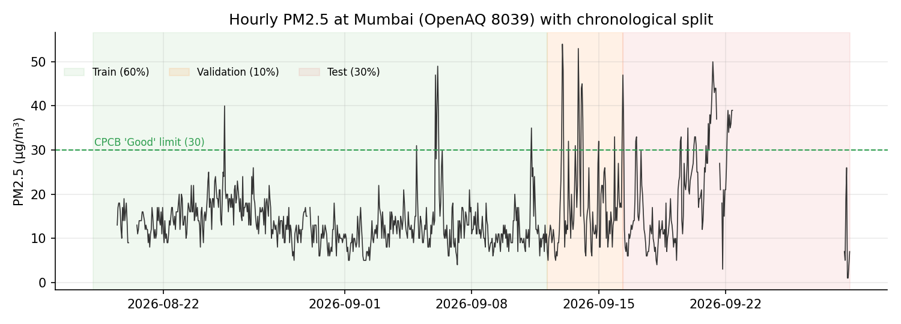
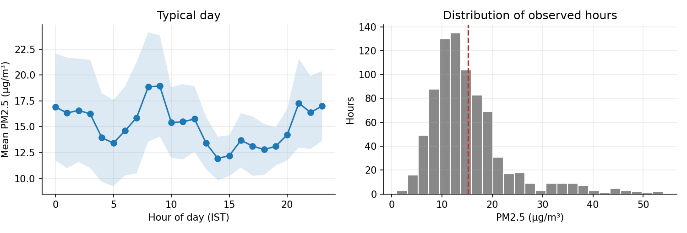
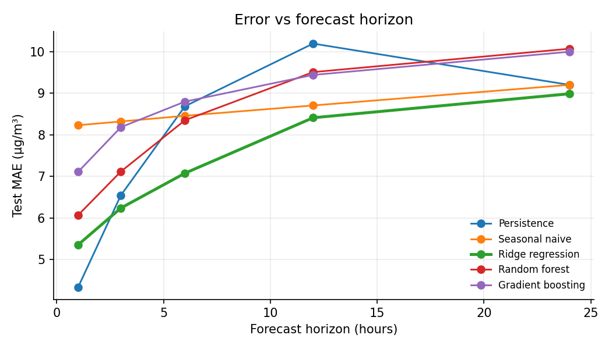
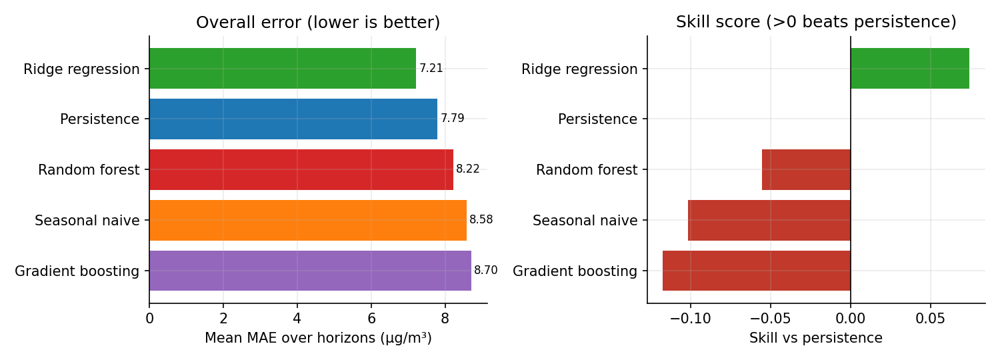
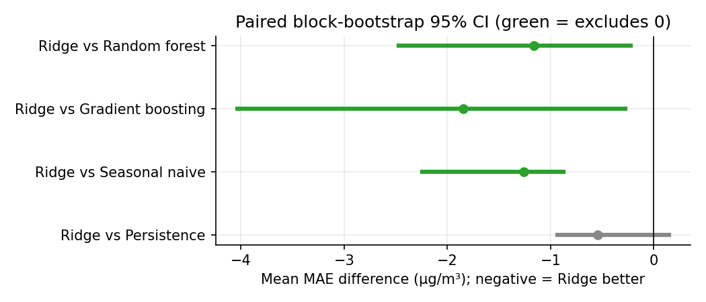
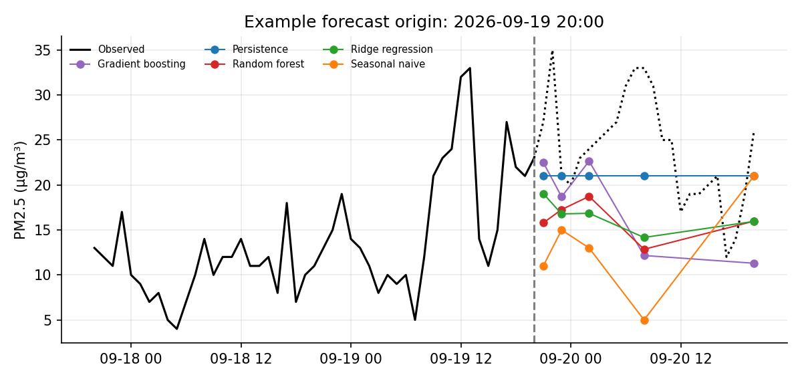

# 🌫️ Short-Term PM2.5 Forecasting for Mumbai


Forecasts **hourly PM2.5 1–24 hours ahead** for Mumbai (OpenAQ location 8039) and tests whether classical ML models can beat simple baselines on a small, real-world dataset.

> **TL;DR:** Ridge regression is the best model overall (mean MAE 7.21 µg/m³ vs 7.79 for persistence, skill +0.07), and it wins from about 3 hours ahead. But the gain over persistence is **not statistically significant**, and the tree models overfit. With ~6 weeks of data, simple beats complex.

---

## 📑 Contents
[Dashboard](#-interactive-dashboard) · [Data](#-data) · [Method](#-method) · [Results](#-results) · [SQL analysis](#-sql-analysis) · [Limitations](#-limitations) · [Run it](#-run-it-yourself) · [Structure](#-project-structure)

---

## 🖥️ Interactive dashboard

A Streamlit app reads `data/` and `results/` and lets you explore everything below interactively.

```bash
python -m streamlit run dashboard.py
```

| Tab | What you get |
|---|---|
| 📊 The data | Hourly PM2.5 over time, typical day, share of hours in each CPCB air-quality band |
| 🏆 Model comparison | Scoreboard and error vs forecast horizon |
| 🔮 Forecast explorer | Pick any test forecast origin and compare every model against what actually happened |
| 🎯 Try it yourself | Build your own 24-hour forecast and compare it with the models |
| ℹ️ About & honesty notes | Method and caveats |

<!-- When you deploy it (e.g. Streamlit Community Cloud), add the link here:
**Live demo:** https://your-app-name.streamlit.app -->

---

## 📦 Data

- **Source:** [OpenAQ](https://openaq.org), location 8039, PM2.5 only, hourly, timestamps in IST.
- **Span:** 18 Aug – 28 Sep 2026, 1,002 hours, about 80% observed. Observed PM2.5 ranges from 1 to 54 µg/m³ with a mean of about 15.
- **Cleaning:** gaps and a 147-hour outage (22–28 Sep) are left as missing. One negative reading (−4) was removed. Gaps up to 12 h are filled by forward-only linear interpolation, so there is no look-ahead.





---

## 🔧 Method

| Step | Detail |
|---|---|
| Models | Persistence and Seasonal naive (baselines), Ridge, Random Forest, Gradient Boosting |
| Features | Past data only: lags (1–168 h), rolling mean/std, recent change, hour of day, day of week |
| Setup | One model per horizon (1, 3, 6, 12, 24 h). 48 h input window, 24 h forecast |
| Split | Chronological 60 / 10 / 30 train / validation / test. Scaling and imputation fitted on train only |
| Scoring | Only on hours that were actually observed |
| Metrics | MAE, RMSE, skill vs persistence, paired block-bootstrap 95% CIs |

---

## 📈 Results

Test set: forecasts issued every 3 hours from 16 Sep to 22 Sep (49 scored origins; the data outage begins on 22 Sep).

### Error vs forecast horizon



Persistence is hard to beat at 1 h, because PM2.5 changes slowly hour to hour. Ridge takes over from about 3 h and stays ahead out to 24 h.

### Scoreboard



| Model | MAE@1h | MAE@3h | MAE@6h | MAE@12h | MAE@24h | Mean MAE | RMSE | Skill vs persistence |
|---|---|---|---|---|---|---|---|---|
| Persistence | **4.33** | 6.54 | 8.68 | 10.19 | 9.20 | 7.79 | 10.05 | 0.00 |
| Seasonal naive | 8.23 | 8.32 | 8.46 | 8.70 | 9.20 | 8.58 | 10.94 | −0.10 |
| **Ridge regression** | 5.35 | **6.24** | **7.07** | **8.41** | **8.99** | **7.21** | **9.58** | **+0.07** |
| Random forest | 6.07 | 7.11 | 8.35 | 9.51 | 10.07 | 8.22 | 10.93 | −0.06 |
| Gradient boosting | 7.11 | 8.18 | 8.80 | 9.44 | 10.00 | 8.70 | 11.70 | −0.12 |

*MAE and RMSE in µg/m³. Skill = 1 − MAE / MAE(persistence).*

### Is Ridge's win real?



Ridge is clearly better than Random forest, Gradient boosting and Seasonal naive (CI excludes 0). Against **persistence** the CI includes 0 (−0.54 µg/m³, 95% CI −0.93 to +0.15), so the advantage is **not statistically significant**.

### Example forecast



All models underestimate this evening's rise, which is typical when there are no weather features. Dotted line = what actually happened.

---

## 🗃️ SQL analysis

`build_db.py` loads the data and results into SQLite (`aqi.db`) and runs the queries in [`sql/queries.sql`](sql/queries.sql):

- data coverage, monthly mean, and hour-of-day profile
- worst days and share of days above the "Good" limit
- MAE by model and horizon, skill vs persistence
- alert quality (precision and recall for PM2.5 above 30 µg/m³ at 6 h)

---

## ⚠️ Limitations

- One station, ~6 weeks of data, no weather features (wind, humidity, rain).
- Distribution shift: train mean (~13.5 µg/m³) is lower than test mean (~19.5 µg/m³).
- Test origins are autocorrelated, so treat all numbers as indicative.
- Observed PM2.5 never exceeds about 54 µg/m³, so high-pollution "event" detection (F1) is barely testable here. Tree models never flag an event.

**Next steps:** add wind and rainfall, add more stations, and collect at least a full year to capture the monsoon and winter cycles.

---

## ▶️ Run it yourself

```bash
pip install -r requirements.txt
python prepare_data.py --raw raw_downloads/ --out data/mumbai_pm25.csv
python run_experiment.py --data data/mumbai_pm25.csv --stations-csv data/stations.csv --out results \
       --train-frac 0.6 --val-frac 0.1 --event-cat 1 --L 48 --H 24
python build_db.py --data data/mumbai_pm25.csv --results results --db aqi.db --run-queries
python -m streamlit run dashboard.py      # optional interactive dashboard
```

To rebuild the charts in this README, run `python make_figs.py`.

---

## 🗂️ Project structure

```
aqi/                    # data loading, models, metrics
raw_downloads/          # OpenAQ export
data/                   # prepared hourly PM2.5 CSV
results/                # metrics, predictions, plots
docs/img/               # charts used in this README
sql/queries.sql         # analysis queries
prepare_data.py         # raw -> clean CSV
run_experiment.py       # train + evaluate
build_db.py             # load into SQLite (aqi.db), run queries
dashboard.py            # Streamlit dashboard
make_figs.py            # regenerates docs/img charts
```

**Data:** [OpenAQ](https://openaq.org) · **Station:** Mumbai (location 8039), 19.073°N, 72.883°E
